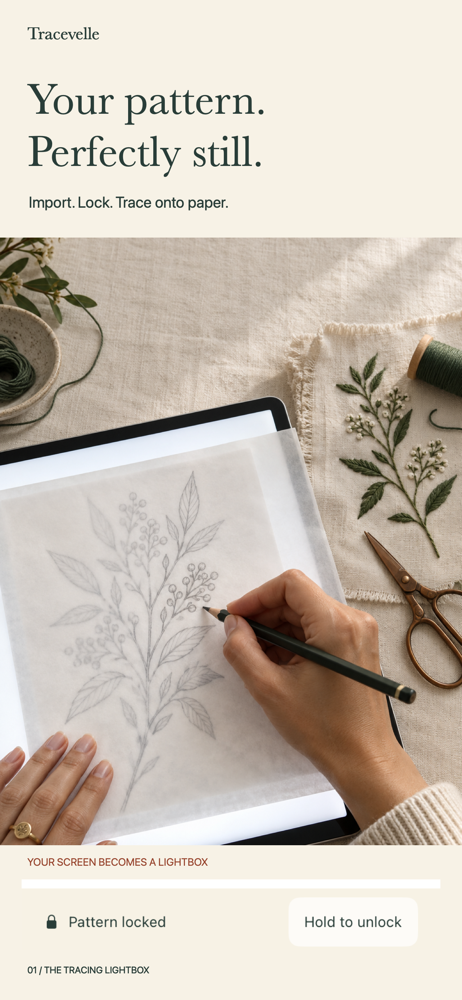
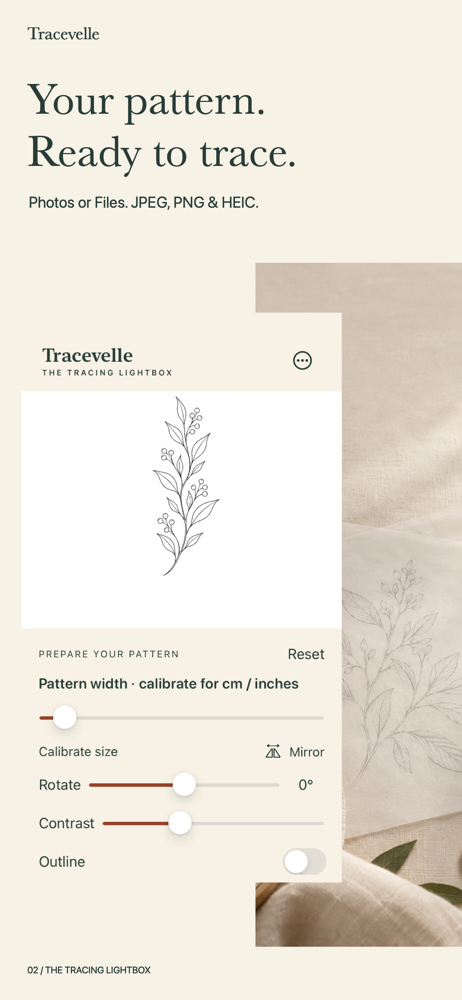
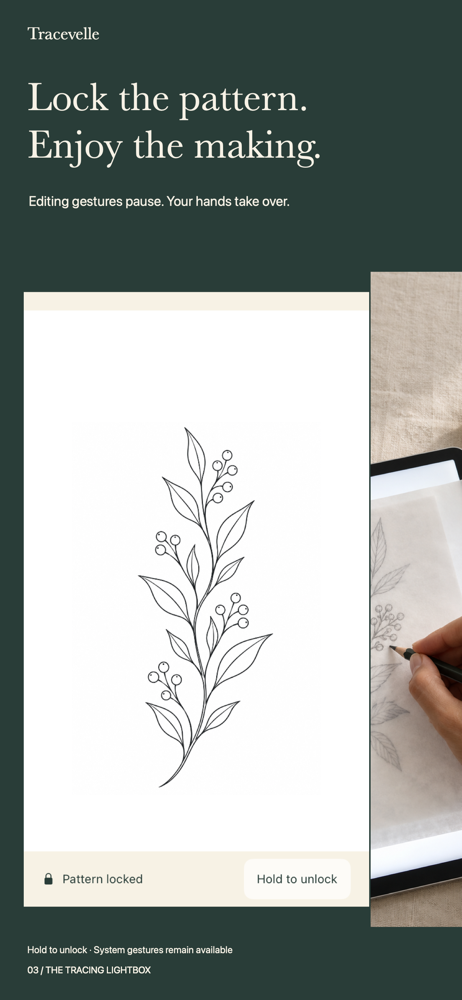
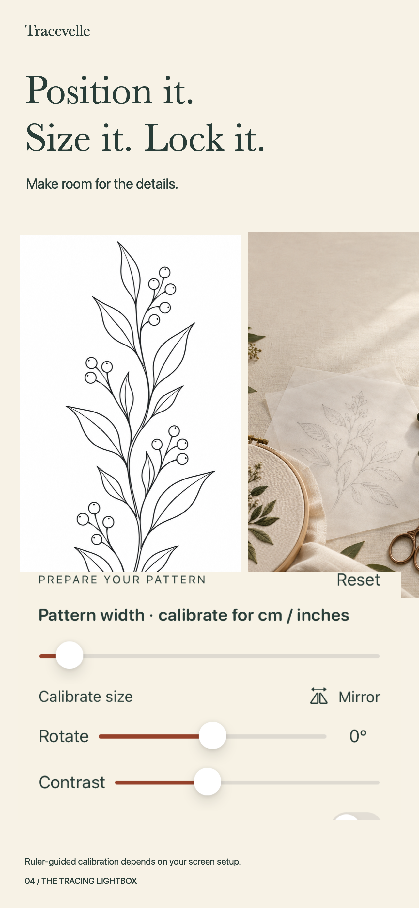
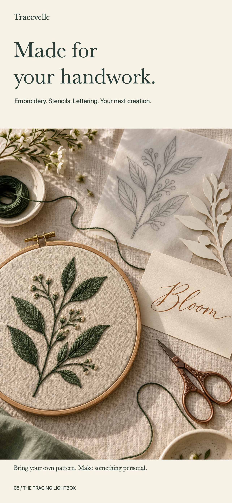
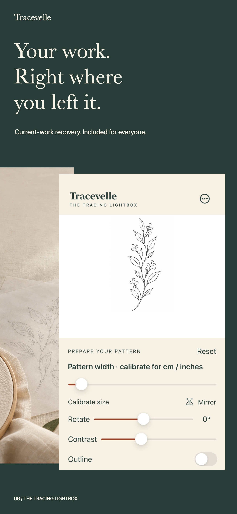
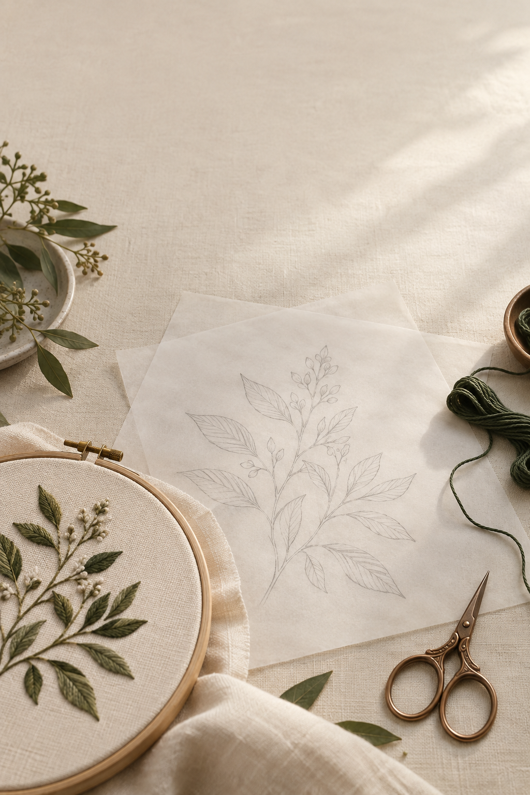

# Tracevelle
### Your pattern. Perfectly still.

A native tracing lightbox for iPhone and iPad, designed and engineered by **Sepideh Javanbakht Dalir**.

**Released October 15, 2026 · Version 1.0 (1).** [Download Tracevelle on the App Store](https://apps.apple.com/us/app/tracevelle-tracing-lightbox/id6816772893). Public US availability was verified against Apple’s catalog. This public repository contains curated product and engineering documentation. Commercial application source remains private.

## A focused tool for physical making

Prepare a small embroidery reference, stencil, lettering study or craft pattern beneath suitable paper. The workflow is deliberately simple:

**Import → Size → Position → Lock → Trace**

The implementation includes Photos/Files image import, resize/rotate/mirror controls, contrast and outline adjustment, ruler-guided calibration, an in-app gesture lock and local current-work recovery. It is a physical tracing utility, with no AI generation, AR tracking, drawing suite or account.

## Engineering

- **Swift and SwiftUI**, Universal iPhone/iPad, deployment target iOS/iPadOS 15.
- **PhotosUI, ImageIO and Core Image** for selected-image import, orientation-correct rendering and native adjustments. Original image bytes are preserved.
- **Codable and atomic local file writes** for current work, named projects and reusable settings.
- **UIKit lifecycle integration** to restore temporary screen brightness and awake settings.
- **StoreKit 2** for a one-time Lifetime Pro purchase, verified entitlements, restore and transaction updates.
- **XCTest** for calibration calculations, display invalidation and persistence integrity. Build/runtime results are recorded separately from physical measurements.

The canvas retains the same geometry when editing controls disappear. Calibration is tied to display/window configuration instead of assuming a universal screen density. Saved originals are immutable, and a failed import does not intentionally replace existing work.

## Privacy and pricing approach

Patterns stay on device. No backend, account, ads or analytics SDK. Apple handles payments. System device backups may include local app data.

The complete single-image tracing workflow and current-work recovery are free. Lifetime Pro adds a named pattern library and reusable size/contrast presets. Pricing is a commercial experiment, not evidence of demand.

## Production status

| Area | Status |
| --- | --- |
| Product strategy | Frozen focused V1; existing portfolio research informs the experiment |
| Native implementation | Universal native implementation; focused workflow tests and Apple archive validation passed |
| Automated core checks | Core persistence/calibration, iPhone/iPad workflow and local StoreKit integration checks passed September 27, 2026 |
| Physical scale and paper suitability | Deferred / non-blocking for V1; setup-dependent guidance, no unverified precision claims |
| StoreKit | Local StoreKit Test verified $2.99 price loading, purchase, restore and revocation; no production-charge claim |
| Icon | Final icon; inspected at 40px |
| Premium screenshot campaign | Locked six-image iPhone and six-image iPad campaign, shown below |
| App Store / release | Version 1.0 (1) released October 15, 2026; public US App Store listing verified |

## Launch campaign

Real native interface captures meet botanical craft photography, linen, paper and stitched outcomes. The iPad compositions use the larger canvas and side controls. Photography illustrates the workflow; it is not evidence of material or physical-scale performance.

[iPad campaign](assets/ipad) · [Full campaign preview](assets/campaign-preview.png) · [Privacy policy](PRIVACY.md)

[Download Tracevelle on the App Store](https://apps.apple.com/us/app/tracevelle-tracing-lightbox/id6816772893). Availability may vary by storefront.

## Visual identity

Botanical ink, warm linen and burnished copper connect the interface to physical craft. This generated editorial still life is supporting artwork, not an app screenshot or material-performance evidence.

## About the developer

**Sepideh Javanbakht Dalir** · [arvinify.com](https://www.arvinify.com) · [hello@arvinify.com](mailto:hello@arvinify.com)

Product strategy, UX, iOS engineering, StoreKit integration, privacy, testing, branding, ASO and release preparation.

© 2026 Sepideh Javanbakht Dalir. All rights reserved.
